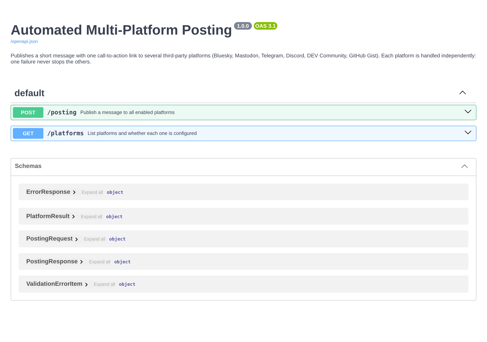

# Automated Multi-Platform Posting

A FastAPI service with one endpoint, `POST /posting`, that validates a short message and publishes it to
**6 third-party platforms** through their official APIs. Each platform runs independently and concurrently:
if one fails, the others still post, and the response reports every platform separately.

| Platform | API used | What gets published | Public? |
|---|---|---|---|
| **Bluesky** | AT Protocol XRPC: [`createSession`](https://docs.bsky.app/docs/api/com-atproto-server-create-session), [`createRecord`](https://docs.bsky.app/docs/advanced-guides/posts) | A post, with the link made clickable (rich-text facet) | Yes |
| **Mastodon** | [`POST /api/v1/statuses`](https://docs.joinmastodon.org/methods/statuses/#create) | A public status (toot) | Yes |
| **Telegram** | Bot API [`sendMessage`](https://core.telegram.org/bots/api#sendmessage) | A message in a public channel (`t.me/<channel>/<id>`) | Yes |
| **Discord** | [Execute webhook](https://discord.com/developers/docs/resources/webhook#execute-webhook) (`?wait=true`) | A message in a server channel | No: members only |
| **DEV Community** | Forem [`POST /api/articles`](https://developers.forem.com/api/v1#tag/articles/operation/createArticle) | A published article | Yes |
| **GitHub Gist** | [`POST /gists`](https://docs.github.com/en/rest/gists/gists#create-a-gist) | A public gist | Yes |

All six are free and use simple token authentication, so they can be set up without an app review.

**Platforms considered and not used:**
- **X (Twitter):** posting needs a paid API tier.
- **LinkedIn and Facebook:** posting needs app review / Marketing API approval.
- **Reddit:** new accounts posting links are usually rate-limited or removed by spam filters.
- **LLM platforms (OpenAI, Claude, Gemini):** their APIs generate text but have no public publishing endpoint, so nothing posted there would get a public URL.

## How it works

```
POST /posting ──► PostingRequest (Pydantic validation)
                     │  ≤ 200 chars, exactly one http(s) link, valid public domain
                     ▼
               PostingService ── asyncio.gather ──┬─► BlueskyPlatform.publish()
                     │   (one shared httpx client, ├─► MastodonPlatform.publish()
                     │    timeout per request)     ├─► … one task per platform
                     ▼                             ┘   errors caught per platform
               verify public access (anonymous GET of each posted URL)
                     ▼
               PostingResponse { success, results[] }
```

- **Platform selection** is internal: `ENABLED_PLATFORMS` in `.env` picks the platforms and their order.
  A platform with missing credentials is reported as `failed` with `Not configured: set …`, without calling its API.
- **Error handling:** every platform is wrapped separately. API errors (with the platform's own message),
  401/403 authentication errors, 429 rate limits, timeouts and network errors become an `error` string for that
  platform only. `success` is `true` when at least one platform published the message.
- **Public access** is checked, not assumed. The platform must report the content as public, and an anonymous
  `GET` of the posted URL must succeed (turn off with `VERIFY_PUBLIC_ACCESS=false`).
- **Date and time** are recorded when each post succeeds, in `TIMEZONE` (default `Asia/Kolkata`).
- **Adding a platform:** write a `Platform` subclass with `name`, `required_settings` and `publish()` in
  `app/platforms/`, then register it in `app/platforms/__init__.py`.

## Project structure

```text
app/
├── main.py                  # FastAPI app, routes, validation-error format
├── config.py                # Settings from environment variables / .env
├── schemas.py               # Request/response models
├── validators.py            # Message + CTA link rules
├── platforms/
│   ├── base.py              # Platform interface, error handling helpers
│   ├── bluesky.py  mastodon.py  telegram.py
│   ├── discord.py  devto.py     github_gist.py
│   └── __init__.py          # Registry + ENABLED_PLATFORMS selection
└── services/
    └── posting_service.py   # Concurrent, independent posting + public-access check
tests/                       # 28 tests; all HTTP is mocked, no real posts
docs/                        # Screenshots and sample logs
```

## Setup

Requires Python 3.11+.

```bash
git clone <this-repo-url> automated-posting
cd automated-posting
python -m venv .venv
source .venv/bin/activate          # Windows: .venv\Scripts\activate
pip install -r requirements-dev.txt
cp .env.example .env               # then fill in the credentials below
uvicorn app.main:app --host 0.0.0.0 --port 4000
```

Open the API docs at <http://localhost:4000/docs>. `GET /platforms` shows which platforms are configured.

### Getting the credentials

| Variable(s) | How to get it |
|---|---|
| `BLUESKY_HANDLE`, `BLUESKY_APP_PASSWORD` | bsky.app → Settings → Privacy and security → **App passwords** → Add. Handle looks like `name.bsky.social`. |
| `MASTODON_INSTANCE_URL`, `MASTODON_ACCESS_TOKEN` | On your instance: Preferences → **Development** → New application, scope `write:statuses` → copy "Your access token". |
| `TELEGRAM_BOT_TOKEN`, `TELEGRAM_CHANNEL` | Message **@BotFather** → `/newbot`. Create a **public** channel, add the bot as an administrator with "Post messages". Channel = `@channel_username`. |
| `DISCORD_WEBHOOK_URL`, `DISCORD_GUILD_ID` | Server settings → Integrations → **Webhooks** → New webhook → Copy URL. Guild ID: enable Developer Mode, right-click the server → Copy Server ID (optional, used for the message link). |
| `DEVTO_API_KEY` | dev.to → Settings → Extensions → **DEV Community API Keys** → Generate. |
| `GIST_TOKEN` | GitHub → Settings → Developer settings → **Personal access tokens** → token with the `gist` scope. |

`.env` is git-ignored. Never commit real credentials.

## Usage

```bash
curl -X POST http://localhost:4000/posting \
  -H "Content-Type: application/json" \
  -d '{"message": "Check out our latest business platform and grow your online visibility. https://example.com"}'
```

(or `./scripts/sample_request.sh`)

### Response: 200

```json
{
  "success": true,
  "results": [
    {
      "platform": "Bluesky",
      "status": "success",
      "posted_url": "https://bsky.app/profile/<handle>/post/<id>",
      "public_access": true,
      "date": "2026-11-15",
      "time": "10:30:00",
      "error": null
    },
    {
      "platform": "Discord",
      "status": "success",
      "posted_url": "https://discord.com/channels/<guild>/<channel>/<message>",
      "public_access": false,
      "date": "2026-11-15",
      "time": "10:30:01",
      "error": null
    },
    {
      "platform": "DEV Community",
      "status": "failed",
      "posted_url": null,
      "public_access": false,
      "date": null,
      "time": null,
      "error": "Authentication failed (401): unauthorized"
    }
  ]
}
```

### Validation errors: 422

| Input | Error |
|---|---|
| More than 200 characters | `Message must not exceed 200 characters (got 210).` |
| No link | `Message must include exactly one CTA link (http:// or https://).` |
| Two links | `Message must include exactly one CTA link (found 2).` |
| `www.example.com` | `The link 'www.example.com' must start with http:// or https://.` |
| `ftp://…` | `The link 'ftp://…' must use http:// or https://.` |
| `https://localhost`, `https://exa_mple.com` | `… does not have a valid domain name.` |
| `https://192.168.1.10` | `… must use a domain name, not an IP address.` |
| `https://user:pass@…` | `… must not contain a username or password.` |
| Only a link, empty, missing field, not a string, invalid JSON | A matching message |

```json
{ "success": false, "errors": [ { "field": "message", "error": "Message must include exactly one CTA link (found 2)." } ] }
```

Trailing punctuation is not part of the link: in `Visit https://example.com/offer.` the link is
`https://example.com/offer`.

## Tests

```bash
pytest -v
```

The tests cover validation rules, posting to all platforms, partial failures, timeouts and network errors,
unconfigured platforms, the public-access check, platform selection, and the request format for each API
(for example, the Bluesky link facet's UTF-8 byte offsets). They run in CI on Python 3.11–3.13
(`.github/workflows/tests.yml`).

## Screenshots and logs

- `docs/screenshot-swagger.png`: API docs at `/docs`
- `docs/screenshot-try-it-out.png`: `POST /posting` from Swagger "Try it out"
- `docs/samples/run-live-bluesky.txt`: live run with Bluesky configured, `success: true`
  ([the published post](https://bsky.app/profile/kishan-test.bsky.social/post/3n2ganykr7r26))
- `docs/samples/server-live-bluesky.log`: server log for that run (login, post, public-access check)
- `docs/samples/run-unconfigured.txt`: a real run before credentials were added
- `docs/samples/validation-errors.txt`: real 422 responses
- `docs/samples/server.log`: server log for those requests
- `docs/samples/test-run.txt`: test output


